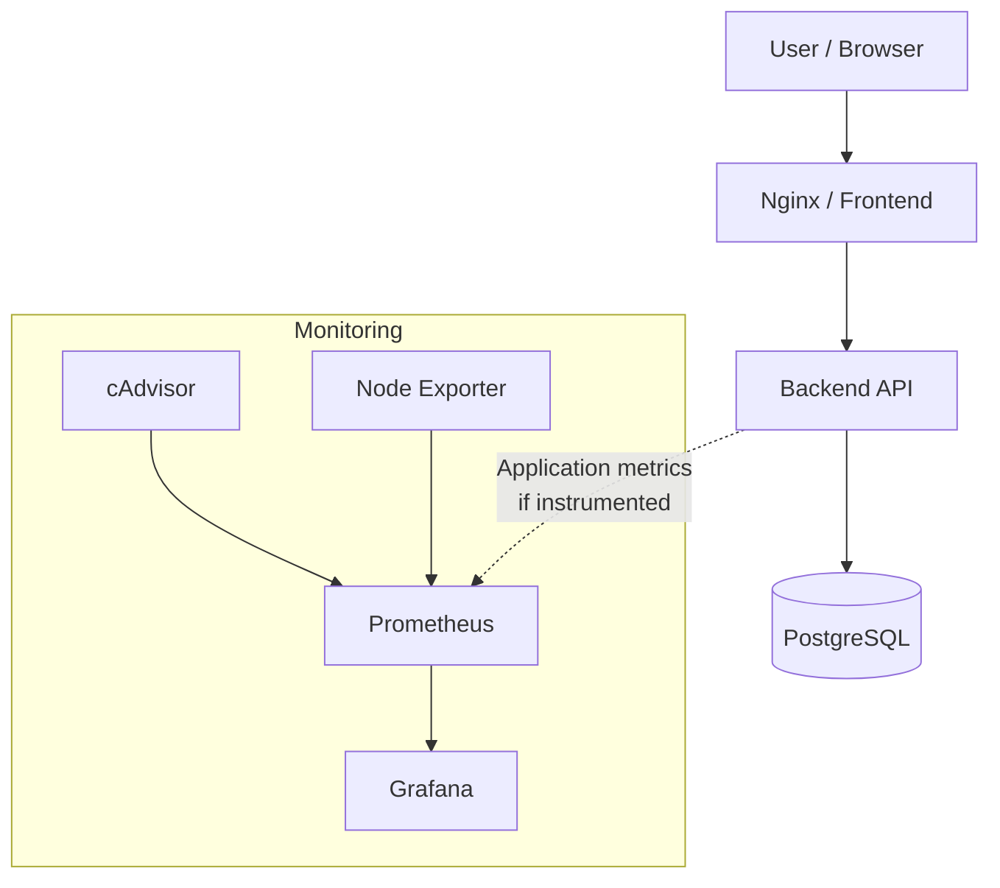

# Jerney DevOps Project

A containerized web application with a PostgreSQL database, automated service orchestration, and infrastructure monitoring using Docker Compose, Prometheus, Grafana, cAdvisor, and Node Exporter.

The project demonstrates practical DevOps workflows, including application containerization, multi-container networking, persistent storage, service health checks, container security, and monitoring.

## Overview

Jerney is a web application built with a frontend, backend API, and PostgreSQL database. The infrastructure is containerized with Docker and Docker Compose, while Prometheus collects metrics from the monitoring stack and Grafana provides dashboards for observability.

### Key Features

- **Containerization:** Docker images for the frontend and backend.
- **Service orchestration:** Docker Compose for managing the application and monitoring services.
- **Database:** PostgreSQL with persistent storage and health checks.
- **Monitoring:** Prometheus for metrics collection and querying.
- **Observability:** Grafana for monitoring dashboards and visualization.
- **Container metrics:** cAdvisor for container resource usage.
- **Host metrics:** Node Exporter for system-level metrics.
- **Reverse proxy:** Nginx configuration for frontend delivery and application routing.
- **Security:** Read-only backend filesystem, `no-new-privileges`, and temporary filesystems where configured.
- **Infrastructure as Code:** Terraform files for infrastructure-related work.
- **DevOps learning roadmap:** Kubernetes orchestration and CI/CD integration as further development goals.

## Architecture



**Architecture notes**

- The frontend is exposed on host port `80`.
- The backend communicates with PostgreSQL over the Docker network.
- PostgreSQL data is stored in a named Docker volume.
- Prometheus scrapes metrics from Prometheus itself, cAdvisor, and Node Exporter.
- Grafana uses Prometheus as its metrics data source.
- Application-level metrics require a compatible metrics endpoint to be implemented and configured.

## Technology Stack

| Category | Technologies |
|---|---|
| Frontend | React, Nginx |
| Backend | Application API |
| Database | PostgreSQL 16 |
| Containerization | Docker, Docker Compose |
| Monitoring | Prometheus |
| Visualization | Grafana |
| Container metrics | cAdvisor |
| System metrics | Node Exporter |
| Infrastructure as Code | Terraform |
| Orchestration learning | Kubernetes |

## Repository Structure

```text
Jerney_DevOps_Project/
├── .github/                 # GitHub workflows and configuration
├── backend/
│   └── Dockerfile           # Backend container image
├── frontend/
│   └── Dockerfile           # Frontend container image
├── deploy/
│   ├── jerney-nginx.conf    # Nginx configuration
│   └── setup.sh             # Deployment/setup script
├── monitoring/
│   └── prometheus.yml       # Prometheus scrape configuration
├── terraform/               # Infrastructure as Code
├── docker-compose.yaml      # Application and monitoring services
├── .gitignore
└── README.md
```

## Prerequisites

Install the following tools before running the project:

- [Git](https://git-scm.com/)
- [Docker Engine](https://docs.docker.com/engine/install/) or Docker Desktop
- [Docker Compose](https://docs.docker.com/compose/)

Verify the installations:

```bash
git --version
docker --version
docker compose version
```

## Getting Started

### 1. Clone the repository

```bash
git clone https://github.com/nadaadel50/Jerney_DevOps_Project.git
cd Jerney_DevOps_Project
```

### 2. Configure environment variables

Create a `.env` file in the repository root:

```bash
nano .env
```

Add the Grafana administrator password:

```dotenv
GRAFANA_ADMIN_PASSWORD=replace_with_a_strong_password
```

Use a strong password and keep `.env` out of version control. Do not commit real passwords, API keys, or other secrets.

> **Security note:** The current Compose configuration also contains PostgreSQL credentials directly in the YAML file. For a production-ready setup, move these credentials into environment variables or a secrets-management solution.

### 3. Build and start the services

From the repository root, run:

```bash
docker compose up -d --build
```

This builds the frontend and backend images and starts the services defined in the Compose file.

Check their status:

```bash
docker compose ps
```

View logs:

```bash
docker compose logs -f
```

Check an individual service:

```bash
docker compose logs -f backend
docker compose logs -f frontend
docker compose logs -f db
docker compose logs -f prometheus
docker compose logs -f grafana
```

### 4. Access the services

Once the containers are running, open the following URLs on the machine hosting Docker:

| Service | URL | Purpose |
|---|---|---|
| Web application | [http://localhost](http://localhost) | Frontend |
| Prometheus | [http://localhost:9090](http://localhost:9090) | Metrics and queries |
| Grafana | [http://localhost:3000](http://localhost:3000) | Dashboards |
| PostgreSQL | `localhost:5432` | Database access from a database client |

Grafana's default username in this configuration is `admin`. Use the password configured in `.env`.

PostgreSQL is exposed on port `5432` in the current Compose configuration. Avoid exposing database ports publicly in a production deployment.

cAdvisor and Node Exporter are not published on host ports in the provided Compose file. Prometheus accesses them internally through the monitoring network.

## Prometheus Configuration

The monitoring configuration is located at `monitoring/prometheus.yml`.

```yaml
global:
  scrape_interval: 15s

scrape_configs:
  - job_name: prometheus
    static_configs:
      - targets: ["prometheus:9090"]

  - job_name: cadvisor
    static_configs:
      - targets: ["cadvisor:8080"]

  - job_name: node-exporter
    static_configs:
      - targets: ["node-exporter:9100"]
```

Prometheus collects metrics every 15 seconds from the configured targets.

To verify the targets, open:

**[http://localhost:9090/targets](http://localhost:9090/targets)**

Check that the targets are marked `UP`. If a target is down, inspect the container logs and verify the service names, ports, and network configuration.

## Grafana Dashboards

Grafana visualizes metrics collected by Prometheus.

1. Open [http://localhost:3000](http://localhost:3000).
2. Sign in with the configured administrator credentials.
3. Add Prometheus as a data source.
4. Set the Prometheus server URL to `http://prometheus:9090`.
5. Save and test the data source.
6. Create or import dashboards for system and container metrics.

Use the Docker service name `prometheus`, rather than `localhost`, for the data source URL when Grafana runs inside the Compose network.

Useful monitoring areas include:

- CPU and memory utilization.
- Container resource consumption.
- Host-level system metrics.
- Prometheus scrape health and target availability.

## Docker Compose Services

| Service | Responsibility |
|---|---|
| `frontend` | Builds and serves the frontend |
| `backend` | Runs the application API |
| `db` | Stores application data in PostgreSQL |
| `prometheus` | Scrapes and stores monitoring metrics |
| `grafana` | Visualizes monitoring data |
| `cadvisor` | Collects container-level metrics |
| `node-exporter` | Exposes host system metrics |

The `monitoring` network connects the monitoring services. Docker Compose also creates a default network for application services that do not specify a separate network.

Named volumes preserve PostgreSQL, Prometheus, and Grafana data across ordinary container recreation.

## Useful Docker Commands

Start the project:

```bash
docker compose up -d
```

Rebuild images and start services:

```bash
docker compose up -d --build
```

List running containers:

```bash
docker compose ps
```

Follow all service logs:

```bash
docker compose logs -f
```

Restart a service:

```bash
docker compose restart backend
```

Stop and remove containers and networks:

```bash
docker compose down
```

Stop the stack and remove its named volumes **(this deletes persisted database and monitoring data)**:

```bash
docker compose down -v
```

## Troubleshooting

**Containers are not starting**

```bash
docker compose ps -a
docker compose logs --tail=100
```

**Grafana fails to start**

Verify that `.env` exists in the repository root and contains a non-empty `GRAFANA_ADMIN_PASSWORD`.

**Prometheus targets are down**

Check the configuration file, service names, ports, and monitoring network:

```bash
docker compose logs prometheus
docker compose exec prometheus \
  promtool check config /etc/prometheus/prometheus.yml
```

**Frontend cannot reach the backend**

Verify the Nginx proxy configuration, backend listening port, and Docker networking. Ensure the frontend uses the correct internal service address rather than `localhost` to reach the backend.

**Database is not ready**

```bash
docker compose logs db
docker compose exec db \
  pg_isready -U jerney_user -d jerney_db
```

## Security Considerations

- Keep secrets out of Git and use environment variables or a secrets manager.
- Replace sample database credentials before production use.
- Avoid exposing PostgreSQL, monitoring endpoints, or administrative interfaces to untrusted networks.
- Pin container images to reviewed versions or digests instead of relying on `latest` for reproducible deployments.
- Run containers with only the privileges they require.
- Review privileged services and host filesystem mounts, particularly cAdvisor and Node Exporter.
- Scan container images and dependencies for vulnerabilities.
- Use HTTPS and appropriate authentication for externally accessible services.


---

*This project is intended for hands-on learning and demonstration of containerization, DevOps practices, and infrastructure monitoring.*
